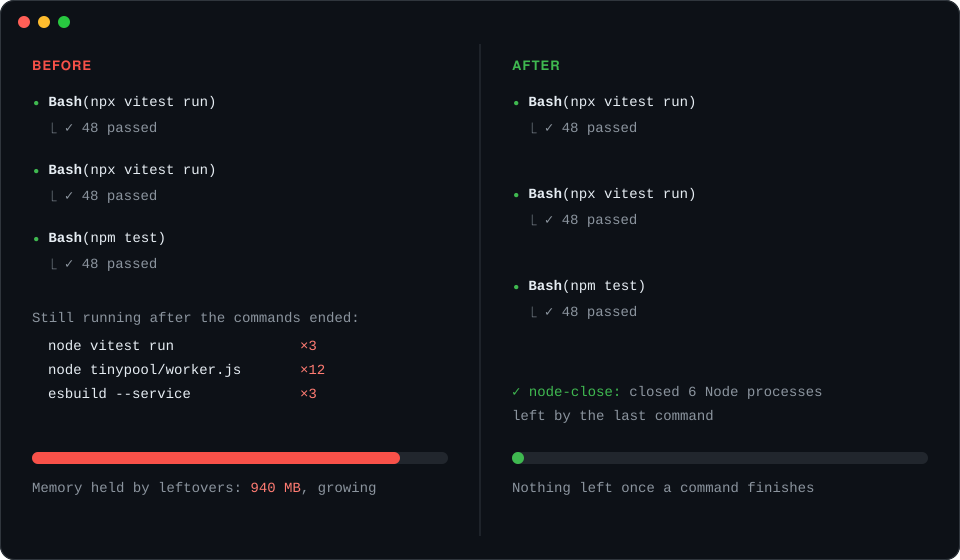

# node-close

<p align="center">
  <strong>Finished commands leave no Node behind.</strong><br>
  A Claude Code mod that ends the Node processes a finished command left running, such as test runners, their workers and esbuild.
</p>

<p align="center">
  <a href="CHANGELOG.md"></a>
  <a href="LICENSE"></a>
  <a href="https://code.claude.com/docs"></a>
  <a href="hooks/register.ts"></a>
  <a href="hooks/register.test.ts"></a>
</p>

<p align="center">
  <a href="#features">Features</a> ·
  <a href="#install">Install</a> ·
  <a href="#usage">Usage</a> ·
  <a href="#development">Development</a> ·
  <a href="CONTRIBUTING.md">Contributing</a> ·
  <a href="CHANGELOG.md">Changelog</a>
</p>



*Illustration of a session before and after.*

When Claude runs tests or builds, the command can finish while Node keeps running: a test runner that never exits, a worker pool, an esbuild service. Claude Code moves on to the next step, and the leftovers pile up and hold memory. node-close checks right after each finished shell command and ends the Node processes that command started and left behind.

> [!NOTE]
> node-close is built on Claude Code's function-hooks mod API, which is in early access and may change between releases.

## Features

- **Ends leftovers at once:** After a Bash or PowerShell command finishes, Node processes it started that are still running are sent `SIGTERM`, then `SIGKILL` after one second if they stay (`taskkill /T` on Windows).
- **Takes their children too:** A Node's esbuild service or worker processes go with it.
- **Only what the command left:** A process counts only when it is new since the command started **and** has lost its parent, re-parented to launchd/init or, on Windows, pointing at a parent that no longer exists.
- **Keeps what you meant to keep:** Node running before the command, your own servers, other sessions, background commands and processes still owned by a running parent are never touched.
- **Respects on-purpose background work:** Commands with `&`, `nohup`, `disown`, `setsid`, `pm2`, `forever`, `--daemon`, `--detach` or `Start-Process` keep their processes; Claude is told the PIDs instead.
- **Tells Claude and you:** Claude gets the PIDs that were ended, and a toast shows the count.

| Situation | What node-close does |
| --- | --- |
| `npx vitest run` finishes, its runner and workers keep running | Ends them, tells Claude which PIDs |
| A process ignores `SIGTERM` | Kills it after one second; reports any that still remain |
| `nohup node server.js &` | Keeps it, tells Claude how to end it later |
| `npm run dev` with `run_in_background`, or moved to the background | Leaves it alone |
| `git status`, `ls` and other commands that cannot start Node | Not checked |

## Install

In a Claude Code **terminal** session, run:

```
/plugin install node-close --marketplace AnnihilationWizard/node-close
```

1. Answer `y` to add the `github:AnnihilationWizard/node-close` marketplace.
2. Choose a scope. The **user** scope loads the mod in every session.
3. Claude Code confirms `Installed node-close. Plugin is now active.` The mod works in the current session without a restart.

To update later, run `claude plugin update`, then `/reload-plugins`.

<details>
<summary>Run from a local clone instead</summary>

```bash
git clone https://github.com/AnnihilationWizard/node-close.git
claude --plugin-dir ./node-close
```

To load a clone in every session, add it to the `env` block of `~/.claude/settings.json`:

```json
{
  "env": { "CLAUDE_CODE_PLUGIN_DIRS": "/path/to/node-close" }
}
```

</details>

## Usage

Once installed, there is nothing to configure. Ask Claude to run your tests; when the command finishes, any Node it left running is closed.

### Limitations

- Only commands Claude runs through Bash or PowerShell are checked, not commands you run yourself.
- A command is checked only when it may start Node: it names `node`, `npm`, `npx`, `pnpm`, `yarn`, `bun`, a common test or build tool, a `.js`, `.ts` or `.sh` file, or `make`. A Node started by some other wrapper is not cleaned up.
- A Node that keeps its parent alive, for example under a daemon that stays running, is not counted as a leftover.
- An `&` inside quotes, such as in a URL, is read as background work, so that command's leftovers are reported instead of ended.
- Processes are listed with `ps` on macOS and Linux and with PowerShell's `Win32_Process` on Windows; if neither works, nothing is checked.
- The `/plugin install` command is available in terminal sessions only. A user-scope install also loads in the desktop app's Code tab.

## Development

```bash
claude plugin validate .   # manifest, marketplace file and hooks module
claude plugin test .       # hooks/*.test.ts against the engine
```

After Claude Code first loads the mod, it writes the API types to `.claude-plugin/types/` (git-ignored). Type-check against them with TypeScript 5.4 or newer:

```bash
npx -p typescript@5 tsc -p .
```

Run `claude --plugin-dir .` to try changes. In an interactive session the folder is watched, and saving a file reloads the mod.

## Project Structure

```text
.claude-plugin/   plugin.json manifest and marketplace.json
hooks/            hooks.json, the hooks module and its tests
docs/images/      README illustration
```

## Contributing

Bug reports and ideas are welcome. Read [CONTRIBUTING.md](CONTRIBUTING.md) before opening an [issue](https://github.com/AnnihilationWizard/node-close/issues) or pull request, and follow [SECURITY.md](SECURITY.md) for security reports.

## License

[MIT License](LICENSE). Copyright © 2026 [AnnihilationWizard](https://github.com/AnnihilationWizard).
